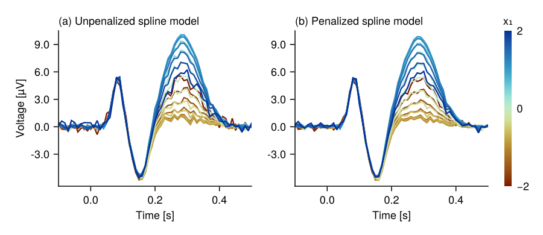

# UnfoldPenalizedSplines.jl

A standalone companion package for additive penalized splines in [Unfold.jl](https://github.com/unfoldtoolbox/Unfold.jl). Use `fit_pspl(...)` with the standard Unfold release to estimate a cubic spline and REML smoothing strength for each predictor.

## Files

The numerical code is reused from [Penalized-Splines](https://github.com/Mango-Wang2024/Penalized-Splines/tree/4d8d6e2159bd7a571f32de7b0561f8482f6cf5f4). The integration code connects these calculations to Unfold's formulas, fitting and prediction.

### 🟦 Reused numerical code

| File | Purpose |
| --- | --- |
| [BSpline.jl](src/BSpline.jl) | Constructs and centers $B,S$. |
| [ModelInputs.jl](src/ModelInputs.jl) | Prepares $X_0,Z$ from $B,S$. |
| [SharedVariance.jl](src/SharedVariance.jl) | Sets one shared variance per spline. |
| [SplineFit.jl](src/SplineFit.jl) | Estimates coefficients and smoothing strengths through REML. |

### 🟩 Unfold integration

| File | Purpose |
| --- | --- |
| [UnfoldPenalizedSplines.jl](src/UnfoldPenalizedSplines.jl) | Loads components and exports public functions. |
| [terms.jl](src/terms.jl) | Defines `pspl` and supplies spline columns. |
| [fit.jl](src/fit.jl) | Connects standard Unfold fitting to the REML solver. |

### 🟨 Example and data

| File | Purpose |
| --- | --- |
| [two_predictors.jl](examples/two_predictors.jl) | Runs the two-predictor example. |
| [erp_effects.jl](examples/erp_effects.jl) | Compares unpenalized and REML-smoothed ERP effects. |
| [plot_erp_effects.jl](assets/plot_erp_effects.jl) | Draws the two-panel ERP figure with UnfoldMakie and CairoMakie. |
| [training.csv](examples/data/training.csv) | 200 observations for fitting. |
| [prediction_grid.csv](examples/data/prediction_grid.csv) | 961 points for evaluating predictions. |

### 🟪 Results and package setup

| File | Purpose |
| --- | --- |
| [RESULTS.md](results/two_predictors/RESULTS.md) | Results and links to numerical outputs. |
| [Project.toml](Project.toml) | Dependencies and compatible versions. |

## Workflow

1. **Construct:** `pspl(x, k)` declares a spline term. Its `modelcols` method constructs $B_j,S_j$ and prepares the unpenalized columns $X_{0,j}$ and penalized columns $Z_j$.
2. **Assemble:** Unfold combines these columns with ordinary predictors and, for continuous data, applies its existing time expansion.
3. **Fit:** `fit_pspl` supplies a solver to Unfold's `fit!`. The solver groups the columns of the assembled matrix into $X_f,Z_1,\ldots,Z_m$ and calls the MixedModels REML fitter.
4. **Return:** coefficients are stored in Unfold's column order for native `predict` and `coeftable`. `smoothing_parameters` returns each fitted $\lambda_j=\sigma^2/r_j^2$ and its variance estimates.

Training knots, centering and coefficient transformations are retained for new-data prediction. The number of predictors is determined by the formula. Supplied full knot vectors can be used with `pspl(:x, k; knots=...)` in programmatically constructed formulas.

Channels and epoched time points are fitted separately. In continuous models, each spline term has one shared smoothing strength across its time-expanded columns. This applies the predictor-spline penalty; regularization along the TRF time axis is a separate modelling step.

## Example

From this repository's root, use Julia 1.11 or later:

```sh
julia --project=. -e 'using Pkg; Pkg.instantiate()'
julia --project=. examples/two_predictors.jl
```

The example uses the research project's 200 saved observations and 961 prediction points for $f(x_1,x_2)=\sin(1.7x_1)+0.15x_1+0.5\cos(1.2x_2)$. Construction and fitting use one call:

```julia
formula = @formula(0 ~ 1 + pspl(x1, 8) + pspl(x2, 8))
model = fit_pspl(formula, events, data, [0.0])
smoothing_parameters(model)
```

As in ordinary Unfold formulas, `0` on the left is a placeholder; the responses are supplied in `data`.

The bundled example retains the original grid RMSE of **0.0794**. [Example results and output data](results/two_predictors/RESULTS.md) include this package's predictions, coefficients, smoothing estimates and execution log. Across the research project's five saved cases, the largest absolute difference from its R-reference grid predictions is **3.8 × 10⁻⁷**. Native Unfold prediction and coefficient reporting are used in these comparisons.

## Marginal effects over time

[ERP example and results](results/erp_effects/RESULTS.md): fit continuous EEG generated with UnfoldSim using our 200 predictor pairs, then use Unfold's `effects` to predict event-related curves at different $x_1$ values, holding $x_2=0$. Both fits keep **$k=8$ per predictor**; one is unpenalized, while the other estimates smoothing through REML.



See the [reproduction commands](results/erp_effects/RESULTS.md#files-and-reproduction) to redraw this figure. The [tutorial](https://mango-wang2024.github.io/UnfoldDocs/UnfoldPenalizedSplines.jl/) demonstrates the same fitting workflow with a quadratic P300 simulation.

## Dependencies and sources

The fitter uses BSplineKit 0.19.3 and MixedModels 5.9.0. Unfold is installed from the Julia package registry. R supplies the saved reference comparisons.

Sources: [StatsModels formula extensions](https://juliastats.org/StatsModels.jl/stable/internals/#Extending-@formula-syntax), [Unfold spline terms](https://github.com/unfoldtoolbox/Unfold.jl/blob/ce1c795faf5968dc623e015fb25af03954e61047/ext/UnfoldBSplineKitExt/splinepredictors.jl), [Unfold custom solver interface](https://github.com/unfoldtoolbox/Unfold.jl/blob/ce1c795faf5968dc623e015fb25af03954e61047/src/fit.jl), and [mgcv smooth-to-random preparation](https://stat.ethz.ch/R-manual/R-devel/library/mgcv/html/smooth2random.html).
