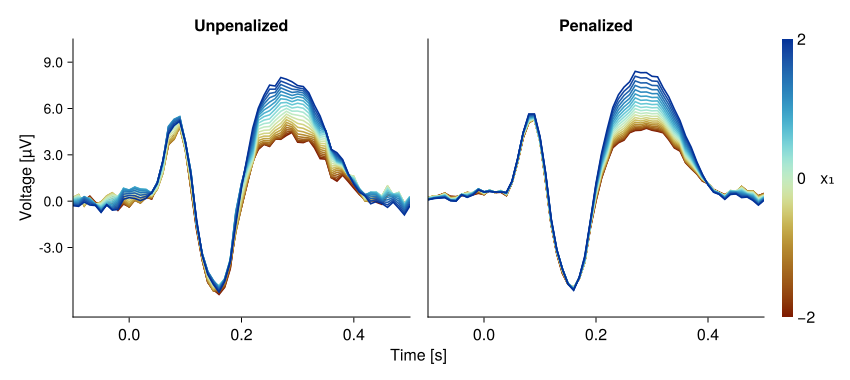

# Penalized splines

Fit two spline models to the same simulated EEG and compare their predicted event-related responses. Both models use the same spline basis. The second estimates the smoothing strengths with REML.

## Load the example data

Run the example from the [package repository](https://github.com/Mango-Wang2024/UnfoldPenalizedSplines.jl). UnfoldSim generated the recording from 200 events. Both predictors affect the height of the P300 peak. [Simulation code and data](https://github.com/Mango-Wang2024/UnfoldPenalizedSplines.jl/blob/main/results/erp_effects/RESULTS.md)

```@raw html
<details><summary>Setup</summary>
```

```sh
julia --project=. -e 'using Pkg; Pkg.instantiate()'
julia --project=assets -e 'using Pkg; Pkg.instantiate()'
```

Start Julia with `julia --project=.` and load the saved recording.

```julia
using Unfold, UnfoldPenalizedSplines, DataFrames, DelimitedFiles

folder = "results/erp_effects"
event_rows, _ = readdlm(joinpath(folder, "events.csv"), ',', Float64; header=true)
recording, _ = readdlm(joinpath(folder, "recording.csv"), ',', Float64; header=true)
events = DataFrame(x1=event_rows[:, 1], x2=event_rows[:, 2],
                   latency=Int.(event_rows[:, 3]))
data = reshape(recording[:, 3], 1, :)
```

```@raw html
</details>
```

## Fit the spline models

Use the same formula and time window for both fits.

```julia
formula = @formula(0 ~ 1 + pspl(x1, 8) + pspl(x2, 8))
basis = firbasis(τ=(-0.1, 0.5), sfreq=100; interpolate=false)

unpenalized = fit(UnfoldModel, formula, events, data, basis)
penalized = fit_pspl(formula, events, data, basis)
```

## Plot the marginal effects

Use `effects()` to predict the response at 21 values of x₁ with x₂ held at zero. Each color represents one x₁ value.

```julia
grid = Dict(:x1 => -2:0.2:2, :x2 => [0.0])
effects_unpenalized = effects(grid, unpenalized)
effects_penalized = effects(grid, penalized)
```



The left panel uses zero penalties. In the right panel, REML estimates λ₁ ≈ 0.6430 and λ₂ ≈ 69.82. The penalties control how much the response can bend across predictor values.

Run `julia --project=. examples/erp_effects.jl` to regenerate the figure. [Example code](https://github.com/Mango-Wang2024/UnfoldPenalizedSplines.jl/blob/main/examples/erp_effects.jl) · [Plot code](https://github.com/Mango-Wang2024/UnfoldPenalizedSplines.jl/blob/main/assets/plot_erp_effects.jl)

## Adjust spline smoothing

Move either slider to see the predictions from a fit with those two smoothing strengths. Both sliders start at the REML estimates. The left plot varies x₁ at x₂ = 0, and the right plot varies x₂ at x₁ = 0.

```@raw html
<iframe id="spline-smoothing-demo" src="assets/smoothing-demo.htm?v=two-sliders" title="Adjust the smoothing strengths of the x1 and x2 splines" loading="lazy" style="display: block; width: 100%; height: 720px; border: 0; background: white; color-scheme: only light;"></iframe>
<script src="assets/embed-demo.js"></script>
```

[Demo fitting](https://github.com/Mango-Wang2024/UnfoldPenalizedSplines.jl/blob/main/assets/fit_smoothing_demo.jl) · [Demo plots](https://github.com/Mango-Wang2024/UnfoldPenalizedSplines.jl/blob/main/assets/plot_smoothing_demo.jl)
