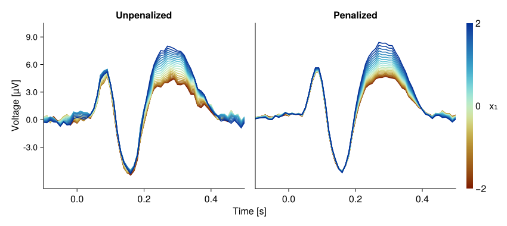

# Penalized splines for EEG

Use the same spline basis to fit the simulated EEG with and without a smoothing penalty. The penalized fit estimates one smoothing strength per predictor using REML.

## Setup

```@raw html
<details><summary>Install the packages</summary>
```

```julia
using Pkg
Pkg.activate(mktempdir())
Pkg.add([
    Pkg.PackageSpec(url="https://github.com/Mango-Wang2024/Unfold.jl.git"),
    Pkg.PackageSpec(url="https://github.com/unfoldtoolbox/UnfoldSim.jl",
                    rev="994f253c2fa0d918357c94180b206732e0b7b2ae"),
    Pkg.PackageSpec(url="https://github.com/Mango-Wang2024/UnfoldPenalizedSplines.jl"),
    Pkg.PackageSpec(name="CairoMakie"),
    Pkg.PackageSpec(name="UnfoldMakie"),
])
```

```@raw html
</details>
```

```julia
using Unfold
using UnfoldSim
using UnfoldPenalizedSplines
using CairoMakie, UnfoldMakie
```

## Simulate EEG with a nonlinear effect

Use UnfoldSim to set the P300 amplitude to 5 + x₁ + 0.2x₁². The second predictor, x₂, is generated after the EEG, so its true effect is zero.

```julia
p3 = (
    p300(; sfreq = 100),
    @formula(0 ~ 1 + continuous + continuous^2),
    [5, 1, 0.2],
    Dict(),
    0,
)
data, evts = UnfoldSim.predef_eeg(; noiselevel = 8, p3 = p3)
evts.x1 = evts.continuous
evts.x2 = rand(UnfoldSim.MersenneTwister(1), size(evts, 1))
```

### Check the first five events

Each row is one event. `latency` is the sample where it begins in the EEG recording.

```julia
first(evts, 5)
```

| Row | continuous | condition | latency | x1 | x2 |
| ---: | ---: | --- | ---: | ---: | ---: |
| 1 | 3.8889 | car | 62 | 3.8889 | 0.0991 |
| 2 | -3.8889 | face | 132 | -3.8889 | 0.7020 |
| 3 | -5.0000 | face | 196 | -5.0000 | 0.5033 |
| 4 | -1.6667 | face | 249 | -1.6667 | 0.8758 |
| 5 | 3.8889 | face | 303 | 3.8889 | 0.9535 |

## Fit the spline models

Fit both models over the same window, from −100 to +500 ms relative to each event. Both calls use the Unfold fork installed above. For the unpenalized fit, the solver takes the design matrix `X.X` from the adapter and uses ordinary least squares. The penalized fit passes the adapter through to the REML solver. Both fits use quantile breakpoints, as in Unfold’s `spl`.

```julia
formula = @formula(0 ~ 1 + pspl(x1, 8) + pspl(x2, 8))
basis = firbasis(τ=(-0.1, 0.5), sfreq=100; interpolate=false)

unpenalized = Unfold.fit(UnfoldModel, formula, evts, data, basis;
                         solver=(X, y) -> Unfold.solver_default(X.X, y))
penalized = Unfold.fit(UnfoldModel, formula, evts, data, basis)
```

## Plot the marginal effects

Predict the EEG at 21 values of x₁ while holding x₂ at 0.5. Each color represents one x₁ value.

```julia
grid = Dict(:x1 => collect(range(-2, 2; length=21)), :x2 => [0.5])
panel_order = ["Unpenalized", "Penalized"]
effects_combined = vcat(
    effects(grid, unpenalized), effects(grid, penalized);
    source=:method => panel_order,
)

plot_erp!(Figure(size=(900, 400)), effects_combined;
    mapping=(; y=:yhat, color=:x1, group=:x1 => nonnumeric,
              col=:method => UnfoldMakie.AlgebraOfGraphics.sorter(panel_order)))
```


