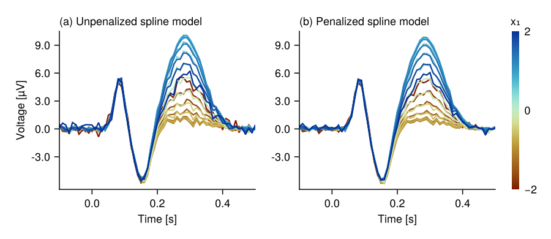

# Marginal ERP effects: fixed basis and REML smoothing



Both panels use **8 basis functions per predictor**, the same simulated recording and the same time-expanded design. The left fit has no smoothing penalty; the right fit estimates each predictor's smoothing strength with REML. The basis size stays fixed.

Each colored curve is Unfold's `effects` prediction at one $x_1$ value, with $x_2=0$. These are predicted responses to an individual event, without overlap from other events. Colors identify predictor values, not error or smoothing strength. Curves need not follow the color order vertically because the simulated effect of $x_1$ is nonlinear.

## Results

RMSE against the known simulated response, across the **21 predictor values × 61 time points shown**:

| Fit | RMSE (µV) |
| --- | ---: |
| Unpenalized, $k=8$ | 0.22374 |
| REML smoothing, $k=8$ | 0.16325 |

REML selected $\lambda_1=0.64298$ and $\lambda_2=69.81969$. Each value is shared across that predictor's lag columns. The penalty controls curvature across predictor values.

## Data and workflow

The example shuffles the original **200 predictor pairs** and passes them to UnfoldSim. It generates a continuous EEG recording with overlapping responses at **100 Hz**, event intervals of **0.2–0.5 s**, and Gaussian noise with standard deviation **0.8 µV** (seed 2026). Unfold fits the response from **−0.1 to 0.5 s**.

UnfoldSim supplies the P100, N170, and P300 waveforms. In our example, the P300 amplitude is $5+4[\sin(1.7x_1)+0.15x_1]+0.5\cos(1.2x_2)$. [Simulation code](../../examples/erp_effects.jl)

`Continuous recording + events → Unfold time expansion → fit → effects → predicted ERP curves`

This is the same figure as in the [penalized spline tutorial](https://mango-wang2024.github.io/UnfoldDocs/UnfoldPenalizedSplines.jl/). It uses UnfoldMakie and CairoMakie to plot the predictions from both fits.

## Files and reproduction

| File | Contents |
| --- | --- |
| [erp_effects.jl](../../examples/erp_effects.jl) | Simulation, both fits and native Unfold `effects` calls. |
| [plot_erp_effects.jl](../../assets/plot_erp_effects.jl) | Makie figure layout and colors. |
| [curves.csv](curves.csv) | Both fits' plotted predictions and known responses. |
| [summary.csv](summary.csv) | RMSE values. |
| [smoothing_parameters.csv](smoothing_parameters.csv) | REML smoothing and variance estimates. |
| [events.csv](events.csv) | Event onsets and predictor values. |
| [recording.csv](recording.csv) | Clean and noisy simulated recording. |
| [run.log](run.log) | Execution output. |

To redraw the saved predictions, run these commands from the repository root:

```sh
julia --project=assets -e 'using Pkg; Pkg.instantiate()'
julia --project=assets assets/plot_erp_effects.jl results/erp_effects/curves.csv assets/erp_effects.png
```

To repeat the simulation and both fits before drawing the figure, install the plotting dependencies as above, then run:

```sh
julia --project=. -e 'using Pkg; Pkg.instantiate()'
julia --project=. examples/erp_effects.jl
```

To regenerate the demo plots in the same run, pass an output folder, for example `julia --project=. examples/erp_effects.jl smoothing-plots`. This also requires `cwebp` on your PATH.
